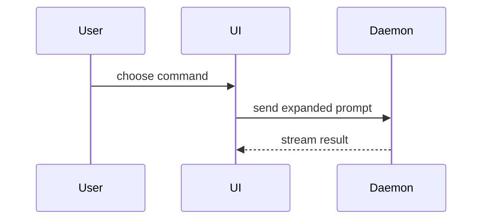

@INTENT.md

# Repository instructions

<!--
These instructions apply to the entire repository unless a more specific
`AGENTS.md` exists in a descendant directory.

This file is the shipped contract between this repository and any coding agent
working in it. Keep it concise, current, and safe to include in derived
repositories.

Replace every placeholder below with real content before publishing a derived
repository. Remove this comment block when done.
-->

These instructions apply to the entire repository unless a more specific
`AGENTS.md` exists in a descendant directory.

## Always-relevant context

### Project identity

<!--
Mirror the Purpose and Primary consumers from INTENT.md.
Use one or two sentences. Do not copy large sections of README.md here.
-->

[Summarise the project in one or two sentences.]

### Technology snapshot

<!--
List the main languages, runtimes, frameworks, package manager, build tools,
test tools, and lint or format tools.
Include exact versions only where compatibility depends on them.
Use the lockfile and project configuration as the source of truth.
-->

- Language(s): [e.g. Python 3.12+ and SQL]
- Runtime(s): [e.g. CPython 3.12 and Docker]
- Framework(s): [e.g. FastAPI]
- Package and environment management: [e.g. uv]
- Build and dependency tooling: [e.g. setuptools, Hatch, or uv]
- Data processing and orchestration: [e.g. pandas, dbt]
- Testing: [e.g. pytest, Hypothesis, and Great Expectations]
- Linting, formatting, and type checking: [e.g. Ruff, Black, isort, and mypy or Pyright]
- Data storage and platforms: [e.g. Snowflake, Amazon S3]
- CI/CD and infrastructure: [e.g. GitHub Actions, GitLab CI/CD, Terraform, or Kubernetes]
- Data operations and platform engineering: [e.g. DataOps.Live, Domino Labs]

### Project map

- `src/`: application or library source code
- `docs/`: long-form documentation, how-to guides, and ADRs
- `.github/`: repository automation and tool-specific instructions
- `AGENTS.md`: repo-wide agent instructions
- `CONTRIBUTING.md`: human contribution workflow
- `CODING_STANDARDS.md`: precise, verifiable code rules
- `CONTEXT.md`: domain model and approved language
- `INTENT.md`: purpose, consumers, scope, and success criteria

## Canonical sources

- `README.md`: human overview, setup narrative, and usage
- `INTENT.md`: purpose, primary consumers, success criteria, and out-of-scope
- `CONTEXT.md` and `GLOSSARY.md`: domain terms, boundaries, and approved language
- `CODING_STANDARDS.md`: naming, imports, error handling, testing rules, and approved or banned patterns
- `CONTRIBUTING.md`: branch, commit, review, and pull request workflow
- `docs/`: durable user, operator, and architecture documentation

## Voice

- Use **ASD-STE100 Simplified Technical English**.
- Use **British English** spelling and grammar.
- Use clear, direct, and consistent language.
- Prefer short sentences and familiar words.

## Commands

<!--
Replace every placeholder with a real command.
Remove rows that do not apply.
Add rows for generation, integration-test, or deployment-preview commands
only when they are part of the normal development workflow.
-->

| Task | Command |
| --- | --- |
| Install dependencies | `[INSTALL COMMAND]` |
| Start local development | `[DEVELOPMENT COMMAND]` |
| Build the project | `[BUILD COMMAND]` |
| Run tests | `[TEST COMMAND]` |
| Run linting | `[LINT COMMAND]` |
| Check formatting | `[FORMAT CHECK COMMAND]` |
| Run type checking | `[TYPE CHECK COMMAND]` |

Run the smallest relevant validation first. Run broader checks only after the
focused check passes, or when the change scope requires it.

## Ways of working

<!--
Keep this section short. List only the rules an agent needs without reading
CONTRIBUTING.md in full. Put detail in CONTRIBUTING.md.
-->

- Create a GitHub Issue before starting any new feature or change.
- Branch from `main`. Use the issue number in the branch name: `feat/123-short-description`.
- Use conventional commits: `type(scope): short description`
- PRs require at least one human review before merge.
- Reference the issue in the PR description: `closes #N`.

See [CONTRIBUTING.md](./CONTRIBUTING.md) for the full contributor workflow.


<important if="you need to understand the problem space, user goals, or domain language before changing code or docs">

- Read `INTENT.md` for purpose, consumers, success criteria, and out-of-scope items.
- Read `CONTEXT.md` for the bounded context and approved terminology.
- Read `GLOSSARY.md` when terms are ambiguous or overloaded.
- Update those files when a change modifies scope, terminology, or core concepts.

</important>

<important if="you need coding, architecture, or testing rules">

- Use `CODING_STANDARDS.md` as the source of truth for precise code rules.
- Do not copy formatter or linter rules into `AGENTS.md` unless tooling cannot
  enforce them and agents repeatedly miss them.
- When the correct pattern is unclear, inspect nearby code and follow the most
  established local pattern.

</important>

<important if="you need branch, commit, review, or pull request workflow">

- Use `CONTRIBUTING.md` as the source of truth for contributor workflow.
- Keep `AGENTS.md` shorter than `CONTRIBUTING.md` and focused on what an agent
  needs during execution.

</important>

<important if="you are changing authentication, authorisation, secrets, infrastructure, schemas, dependencies, or other high-risk boundaries">

- Keep secrets, credentials, tokens, private keys, personal data, and other
  sensitive material out of source code, logs, tests, and documentation.
- Ask for approval before destructive, production-affecting, or
  compatibility-breaking changes unless the repository explicitly says otherwise.
- Prefer changing the source for generated artefacts instead of editing the
  generated output directly.

</important>

<important if="you need to communicate complex concepts and want to support them with visualisations">

Skip the preamble. Keep prose brief. Pick the smallest view that makes the key
point clear.

- Show logic or an algorithm as pseudocode:

```text
on(save)
  if content is unchanged
    return cached result
  write new content
  return fresh result
```

- Show file responsibility or a broad refactor as a shallow file tree:

```text
src/
├── commands/       # parses user actions
├── sessions/       # owns session state
└── transport/      # sends API requests
```

- Show component interaction, control flow, or data flow with Mermaid:



</important>
