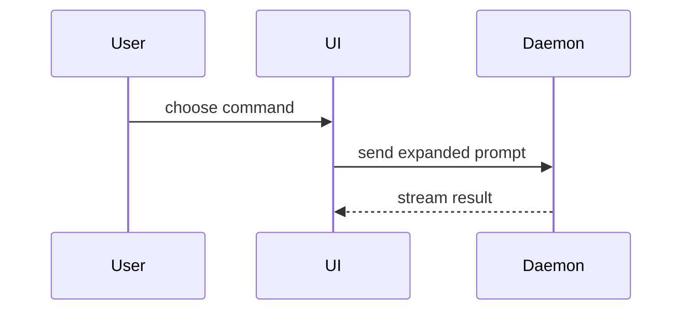

# Contributing

Contributions are welcome: bug reports, feature proposals, documentation,
tests, and code changes.

## Before you start

- Read [README.md](README.md) for setup and [INTENT.md](INTENT.md) for
  purpose and scope.
- Search existing issues and pull requests before you open a new one.
- Open an issue before substantial work. The issue is where the spec and
  the acceptance criteria live.
- Keep secrets, credentials, personal data, and confidential material out
  of issues, commits, and pull requests.

## Ways to contribute

- Report a reproducible bug.
- Propose an enhancement or a new capability.
- Improve documentation, examples, or error messages.
- Add or improve tests.
- Review an open pull request.
- Clarify an existing document or an ambiguous term.

## Setup

The toolchain and its versions are in [README.md](README.md). The
prerequisites for the agent workflow are in [TEMPLATE.md](TEMPLATE.md).

Run the check before and after your change:

```bash
uv run scripts/factory.py check
```

The command list is in `factory.toml`. Do not add a second entry point.

## Making changes

Branch from `main` and use the issue number in the branch name:

```bash
git switch main
git pull --ff-only
git switch -c feat/123-short-description
```

Keep one pull request to one purpose. Do not mix a fix, a refactor, and a
formatting change.

When you change behaviour:

- Add or update a test at the agreed seam.
- Update the documents that describe the behaviour.
- Keep the change as small as the problem allows.
- Do not edit a generated file when its source can be changed instead.

## Commits

Use the conventional commit format:

```text
type(scope): short description
```

- **type**: `feat`, `fix`, `docs`, `refactor`, `test`, or `chore`.
- **scope**: optional; the affected area.
- **description**: imperative, lower case, no full stop, 72 characters or
  fewer.

Reference the issue in the pull request: `Closes #N`.

Each commit describes one coherent change and contains no secrets, local
configuration, or build output.

## Pull requests

A pull request contains three sections:

1. **Summary** — the problem, the approach, and the trade-offs.
2. **Evidence** — the check result, bound to a commit.
3. **Merge Danger** — what can break, and how to revert it.

The evidence block is a comment, so it stays invisible when rendered:

```text
<!-- factory:evidence
commit: <sha>
check: uv run scripts/factory.py check
result: pass
risk: low
-->
```

The commit must equal `HEAD` of the pull request. Evidence from an earlier
commit is stale and is rejected.

Before you open a pull request, read the full diff. Remove temporary
files, debug output, and unrelated changes.

## Review

Review runs on three axes:

- **Standards** — `CODING_STANDARDS.md` and the local conventions.
- **Spec** — the issue and its acceptance criteria.
- **Security** — trust boundaries, secrets, authorisation, and supply
  chain.

Each axis runs in a fresh context. A reviewer receives the task contract,
the spec, the exact commit, and the check command. A reviewer does not
receive the author's reasoning or a proposed verdict.

The review order is: `code-review` (standards and spec axes),
`security-review` (with an attack list, even for a clean verdict),
`verify` (check result against the exact commit), then
`finding-verifier` (challenges every blocker, starting from the
position that it is false).

A blocker must be traced or reproduced before it can block a merge. The
verifier returns one of three outcomes: **confirmed**, **refuted**, or
**unproven**. An unproven finding is recorded and dismissed.

## Risk and merge

- **Low risk**: no protected path, diff below the size ceiling, evidence
  that matches `HEAD`, and no surviving blocker. An agent may merge.
- **High risk**: anything else. A human approves the merge.

The gate decides the lane. Protected paths and the size ceiling are in
`factory.toml`. A change to the harness is always high risk.

Do not merge with a failing check. Do not disable a check to make a
change pass.

## Definition of done

A change is done when:

- The requested behaviour exists.
- A test covers the new behaviour.
- `uv run scripts/factory.py check` passes on the final commit.
- Documentation and the `docs/log.md` entry are current, where relevant.
- The pull request carries valid evidence.
- Every surviving review blocker is resolved.
- The risk gate allows the merge.

## Voice

- Use **ASD-STE100 Simplified Technical English**.
- Use **British English** spelling and grammar.
- Prefer short sentences and familiar words.
- Define a term once, in `GLOSSARY.md`, and use it consistently.

Help the reader understand the topic visually. Pick the smallest view that
makes the key point clear.

Show logic as pseudocode:

```text
on(save)
  if content is unchanged
    return cached result
  write new content
  return fresh result
```

Show file responsibility as a shallow tree:

```text
src/
├── commands/       # parses user actions
├── sessions/       # owns session state
└── transport/      # sends API requests
```

Show interaction or data flow with Mermaid:



## Documentation

- `docs/` is an OKF v0.2 bundle. Every concept carries a `type`.
- Root documents carry no frontmatter.
- Specs and tickets live on the issue tracker, not in `docs/`.
- Add one line to `docs/log.md` for each merged change.
- Do not repeat a rule that another document owns. Link to it.
