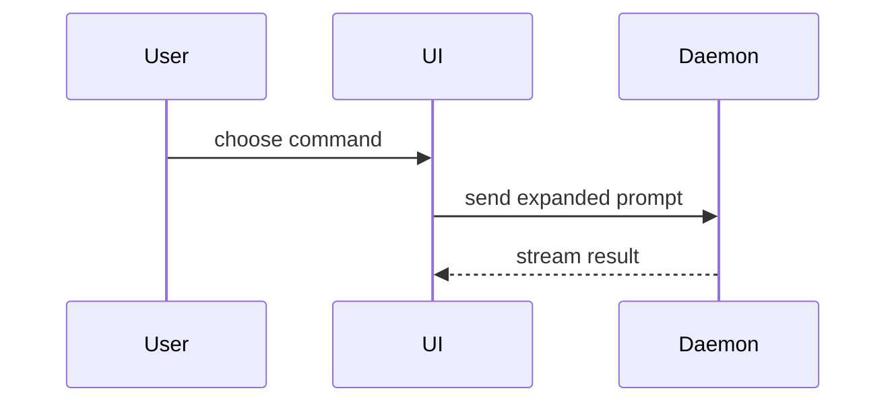

# Contributing to [PROJECT NAME]

Thank you for your interest in contributing to **[PROJECT NAME]**.

Contributions are welcome, including bug reports, feature proposals, documentation improvements, tests, performance improvements, and code changes.

Please read this document before opening an issue or pull request. It explains the contribution process, development workflow, quality expectations, and review requirements.

## Before you contribute

Before starting work:

- Read the [README](README.md) to understand the project and its intended use.
- Search existing issues and pull requests to avoid duplicating existing work.
- Confirm that the proposed change is within the scope of the project.
- For substantial changes, open an issue or discussion before beginning implementation.
- Do not include confidential information, credentials, personal data, or proprietary material in issues, commits, or pull requests.

If an issue is already assigned to someone else, contact the maintainers before starting work on it.

## Ways to contribute

You can contribute by:

- Reporting reproducible bugs.
- Suggesting enhancements or new functionality.
- Improving documentation, examples, or error messages.
- Adding or improving tests.
- Improving performance, accessibility, reliability, or maintainability.
- Reviewing open pull requests.
- Helping to answer questions and clarify existing documentation.

## Reporting bugs

Before opening a bug report, search existing issues to determine whether the problem has already been reported.

Use the repository's bug-report template, where available. Include:

- A concise description of the problem.
- The expected behaviour.
- The actual behaviour.
- Clear steps to reproduce the issue.
- The relevant project version, commit, or release.
- Your operating system, runtime, browser, or other relevant environment details.
- A minimal reproduction, sample input, or reproduction repository where possible.
- Relevant logs, error messages, screenshots, or stack traces.

Remove secrets, credentials, personal data, and other sensitive information before submitting logs or configuration files.

A good bug report should allow another contributor to reproduce the problem without requiring additional context.

## Suggesting enhancements

Before suggesting an enhancement, search existing issues and discussions.

Use the repository's feature-request template, where available. Explain:

- The problem or use case the enhancement would address.
- Who would benefit from the change.
- The proposed behaviour or user experience.
- Any alternative approaches considered.
- Potential compatibility, security, performance, or maintenance implications.
- Whether you would be willing to contribute an implementation.

Describe the problem before prescribing a solution. The maintainers may request additional investigation or discussion before work begins.

## Development setup

### Prerequisites

Install the following tools and versions:

- [Tool]: [required version]
- [Tool]: [required version]
- [Tool]: [required version]

Additional requirements:

- [Environment variable, service, database, or account requirement]
- [Operating system requirement, if applicable]
- [Other prerequisite]

### Clone and install

```bash
git clone [REPOSITORY CLONE COMMAND]
cd [REPOSITORY DIRECTORY]
[DEPENDENCY INSTALL COMMAND]
```

### Configure the local environment

Copy the example configuration:

```bash
[COMMAND TO COPY OR CREATE LOCAL CONFIGURATION]
```

Update the local configuration with appropriate development values.

Do not commit local configuration files, credentials, tokens, private keys, or other secrets. Use **[approved secret-management approach]** for sensitive values.

### Run the project locally

```bash
[DEVELOPMENT COMMAND]
```

The application or service should then be available at:

```text
[LOCAL URL OR ACCESS INSTRUCTIONS]
```

## Making changes

Create a branch from the default branch before making changes:

```bash
git switch [DEFAULT BRANCH]
git pull --ff-only
git switch -c [BRANCH NAME]
```

Keep changes focused. Avoid combining unrelated fixes, refactoring, or formatting changes in the same pull request.

When implementing a change:

- Follow the existing architecture and coding conventions.
- Prefer established project dependencies and patterns.
- Add or update tests for behavioural changes.
- Update documentation when user-facing behaviour, configuration, APIs, or operational procedures change.
- Preserve backwards compatibility unless the change explicitly requires a breaking change.
- Avoid changing generated files directly when they are produced from another source.
- Remove debugging code, temporary files, and unused dependencies before opening a pull request.
- Keep the change as small as reasonably possible while solving the problem.


## Development guide

### Technology and tooling
> <!--List the important technologies and versions.

Include:
- Programming languages
- Frameworks and libraries
- Package manager
- Runtime versions
- Build tools
- Test and lint tools
- Infrastructure or deployment tooling, where relevant

Use exact versions where they affect compatibility.
-->

- Language(s): [e.g. Python 3.12+ and SQL]
- Runtime(s): [e.g. CPython 3.12 and Docker]
- Framework(s): [e.g. FastAPI]
- Package and environment management: [e.g. uv]
- Build and dependency tooling: [e.g. setuptools, Hatch, or uv]
- Data processing and orchestration: [e.g. pandas, dbt]
- Testing: [e.g. pytest, Hypothesis, and Great Expectations]
- Linting, formatting, and type checking: [e.g. Ruff, Black, isort, and mypy or Pyright]
- Data storage and platforms: [e.g. Snowflake, Amazon S3]
- CI/CD and infrastructure: [e.g. GitHub Actions, GitLab CI/CD, Terraform, or Kubernetes]
- Data operations and platform engineering: [e.g. DataOps.Live, Domino Labs]

Use the existing lockfile and project configuration as the source of truth.
Do not change package managers or introduce replacement tooling without approval.

### Coding Standards
See [CODING_STANDARDS.md](./CODING_STANDARDS.md) for ...

### Git and change management
> <!-- Describe repository-specific Git and pull request conventions. Include: - Branch naming - Commit format - Pull request expectations - Required reviewers or ownership rules - Whether commits may be amended or rebased -->
Use the repository's existing branch and commit conventions.

Before proposing a change:

Review the final diff for unrelated modifications.
Remove temporary files, debug output, and local configuration.
Confirm that documentation and tests are updated where necessary.
Summarise the implementation, validation performed, and any limitations.
Do not amend, rebase, force-push, or rewrite existing commits unless explicitly requested.

### Branching and Pull Requests
- Create a GitHub Issue before starting any new feature or change.
- Branch from `main`. Use the issue number in the branch name: `feat/123-description`.
- Open a pull request against `main`. Reference the issue in the PR description.
- PRs require at least one human review before merge.

### Commits
Use conventional commit format: `type(scope): short description`

- **type** — `feat`, `fix`, `docs`, `refactor`, `test`, `chore`
- **scope** — optional; the affected area.
- **description** — imperative, lower-case, no full stop; 72 characters or fewer

Example: `docs(playbook): add Phase 6 schema-contract step`

Reference the issue number in the commit body or PR description: `closes #N`.

Each commit should:

- Describe one coherent change.
- Avoid unrelated formatting or generated changes.
- Pass the relevant local checks where practical.
- Avoid including secrets, credentials, local configuration, or build artefacts.

### Opening a pull request

Before opening a pull request:

- Review the complete diff against the target branch.
- Confirm that relevant tests, linting, formatting, type checks, and builds pass.
- Confirm that the pull request does not contain confidential or sensitive information.
- Ensure that the branch is up to date with the target branch where required.

Use the repository's pull-request template, where available.

The pull request description should include:

- A concise summary of the change.
- The problem being addressed.
- The approach taken.
- Important design decisions or trade-offs.
- Tests and validation performed.
- Documentation updated.
- Known limitations or follow-up work.
- The issue or discussion addressed by the change.

Link related work using the repository's preferred format. For example:

```text
Closes #[ISSUE NUMBER]
```

For changes that affect user-facing behaviour, include before-and-after examples, screenshots, recordings, or other useful evidence where appropriate.

Keep pull requests focused. If a change is large, explain why and describe how it could be divided into reviewable parts.

### Development commands
><!--Replace every placeholder with a real command. Remove commands that do not apply.

Include commands for:
- Installing dependencies
- Starting local development
- Building
- Running unit tests
- Running integration or end-to-end tests
- Linting
- Formatting
- Type checking
- Generating code or database clients, where applicable
-->

Install dependencies:

```bash
[command]

```

### Architecture and implementation conventions

> <!--
> Document the architectural boundaries and layering rules.
> Naming conventions, error-handling patterns, and import rules belong in
> CODING_STANDARDS.md — do not repeat them here.
>
> Include:
> - Where business logic belongs (which layer or directory)
> - How dependencies flow (which modules may import which)
> - API or module boundaries
> - State-management patterns
> - Data-access patterns
> - Logging and observability conventions
> - Backwards-compatibility requirements
> -->

Follow the existing architecture and patterns before introducing new ones.

Put [type of logic] in [path or layer].
Keep [component/controller/handler] responsible only for [specific responsibility].
Access [database/API/external service] through [approved abstraction].
Preserve backwards compatibility for [APIs, schemas, public packages, or interfaces].
Do not introduce a new dependency when an existing project dependency provides the required capability.
When a suitable existing pattern is unclear, inspect nearby code and follow the most established pattern.

For naming conventions, error-handling patterns, and module rules,
see [CODING_STANDARDS.md](./CODING_STANDARDS.md).

### Testing expectations

> <!--
> Define when tests are required and where they live.
> Test file naming, describe/it structure, and mocking rules belong in
> CODING_STANDARDS.md — do not repeat them here.
>
> Include:
> - When tests are required (behaviour changes, bug fixes, new features)
> - Where each test type lives (unit, integration, end-to-end paths)
> - Coverage target or quality bar
> - How to handle flaky or locally unavailable tests
> -->

Add or update tests when changing behaviour.

Unit tests belong in [path].
Integration tests belong in [path].
End-to-end tests belong in [path].
Maintain at least [coverage or quality requirement], where applicable.
Do not remove, weaken, or skip a test to make the validation suite pass.
If a test cannot be run, state the reason and identify the alternative validation completed instead.

For test file naming, structure, and mocking conventions,
see [CODING_STANDARDS.md](./CODING_STANDARDS.md).

### Testing and validation

Run the smallest relevant checks during development. Before opening a pull request, run the complete validation required for the affected area.

Run unit tests:

```bash
[UNIT TEST COMMAND]
```

Run integration tests:

```bash
[INTEGRATION TEST COMMAND]
```

Run end-to-end tests:

```bash
[END-TO-END TEST COMMAND]
```

Run linting:

```bash
[LINT COMMAND]
```

Check formatting:

```bash
[FORMAT CHECK COMMAND]
```

Run type checking:

```bash
[TYPE CHECK COMMAND]
```

Build the project:

```bash
[BUILD COMMAND]
```

A contribution must not knowingly reduce test coverage, weaken validation, or disable a quality check simply to make the build pass.

If a check cannot be run locally, explain why in the pull request and state which alternative validation was completed. Continuous integration checks must pass before a pull request can be merged unless a maintainer has explicitly approved an exception.


###  Security, privacy, and boundaries
><!-- Replace or extend these rules for the project. Be explicit about sensitive files, production resources, generated files, vendor code, and destructive operations. -->
Always:

Keep secrets, credentials, tokens, private keys, and personal data out of source code, logs, commits, and pull requests.
Use the repository's approved secret-management and configuration mechanisms.
Validate external input at the appropriate system boundary.
Apply the project's authentication, authorisation, and data-protection conventions.
Review security implications when changing dependencies, data flows, APIs, permissions, or deployment configuration.
Ask for approval before:

Modifying production infrastructure or deployment configuration.
Changing database schemas, migrations, or persistent data.
Changing public APIs, contracts, or shared interfaces.
Adding or upgrading significant dependencies.
Performing irreversible or potentially destructive operations.
Changing authentication, authorisation, encryption, or privacy controls.
Deleting files, tests, data, or substantial functionality.
Never:

Commit secrets or sensitive information.
Disable security controls to make a test or build pass.
Edit generated files when the source generator should be changed instead.
Modify vendored or third-party code unless explicitly required.
Run destructive commands against shared or production environments.
Conceal failed checks, known limitations, or material implementation risks.

### Continuous Integration (CI)

> <!--
> Describe the CI pipeline.
> Include: CI platform, trigger conditions, required checks, config file location,
> and how to investigate or re-run a failing job.
> -->

This project uses [CI platform, e.g., GitHub Actions / Azure Pipelines / CircleCI].

CI runs on:

- Every push to `[DEFAULT BRANCH]`
- Every pull request opened against `[DEFAULT BRANCH]`

Required checks before merge:

- [Check name, e.g., lint]
- [Check name, e.g., unit-tests]
- [Check name, e.g., build]

CI configuration lives in [`[path to CI config, e.g., .github/workflows/]`]([path]).

To investigate a failing run, open the **[Actions / Pipelines]** tab in the repository and select the failing workflow. Re-run a job by selecting **Re-run failed jobs**.

## Definition of done
A task is complete when:

The requested behaviour or change has been implemented.
The implementation follows the relevant architectural and security rules.
Appropriate tests have been added or updated.
Relevant formatting, linting, type checks, and tests pass.
Documentation and generated files are up to date, where applicable.
The final diff contains no unrelated changes.
Any checks that could not be run, known limitations, and follow-up work are clearly reported.

## Local instructions
<!-- Add repository-specific rules that do not fit naturally above. Examples: - A known workaround - A required order of operations - A non-obvious compatibility constraint - A local development prerequisite - A rule for a particular file format -->
[Add project-specific instruction]
Plain Text

## Writing styles
- Use **ASD-STE100 Simplified Technical English**.
- Use **British English** spelling and grammar.
- Use clear, direct, and consistent language.
- Prefer short sentences and familiar words.

## Documentation and generated files
><!-- Specify documentation requirements and identify generated content. -->
Update documentation when a change affects public behaviour, setup, configuration, APIs, operations, or user-facing functionality.

Keep generated files consistent with their source. If a generated file changes, identify the generation command and use it where available.

Do not duplicate information that is already maintained in another authoritative document. Reference the authoritative source instead.

When creating project documentation, assess whether if it is convenient to follow the Open Knowledge Framework (OKF) (See: https://github.com/GoogleCloudPlatform/knowledge-catalog/blob/main/okf/SPEC.md) or to adopt similar patterns.


Help the readers understand the topic visually. Pick the smallest view that makes the key point clear.

- Show logic or an algorithm as pseudocode:

```text
on(save)
  if content is unchanged
    return cached result
  write new content
  return fresh result
```

- Show file responsibility or a broad refactor as a shallow file tree:

```text
src/
├── commands/       # parses user actions
├── sessions/       # owns session state
└── transport/      # sends API requests
```

- Show component interaction, control flow, or data flow with Mermaid:



